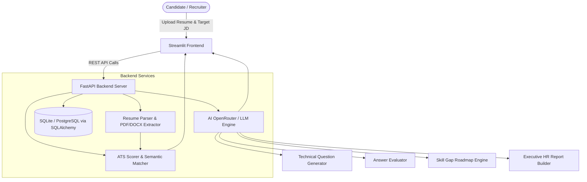

<div align="center">

# 🤖 InterviewIQ AI
### **AI-Powered Resume Analyzer, ATS Scorer & Technical Interview Coach**

[](https://python.org)
[](https://fastapi.tiangolo.com)
[](https://streamlit.io)
[](https://openrouter.ai)
[](LICENSE)

*Know your fit before you apply. Analyze resumes against job requirements, practice targeted AI technical interview questions, and receive actionable feedback in real time.*

---

</div>

## 📌 Overview

**InterviewIQ AI** is an end-to-end intelligent career preparation and recruiting platform. It combines natural language processing (NLP), semantic similarity matching, and large language models (LLMs) to bridge the gap between job candidates and hiring standards.

Candidates upload their resume (in PDF, DOCX, or text format) and compare it against any target job description. The platform calculates an ATS compatibility score, highlights matched and missing skills, generates personalized technical interview questions, evaluates submitted answers, creates a 4-week learning roadmap, and exports an HR assessment report.

---

## ✨ Key Features

- **Universal Resume Parsing:** Extracts contact information (name, email, phone) and technical skills from PDF, DOCX, DOC, and TXT resumes using `pdfplumber`, `python-docx`, and `spaCy`.
- **Hybrid ATS Compatibility Engine:** Combines keyword overlap with TF-IDF cosine semantic similarity for accurate job-match scoring.
- **Skill Gap & Match Analysis:** Visualizes matched vs. missing skills with interactive Plotly charts and badges.
- **Actionable Optimization Tips:** Suggests specific resume improvements (action verbs, quantifiable metrics, keyword alignment).
- **Interactive AI Mock Interview:** Generates role-tailored technical questions using Meta LLaMA / GPT-4o via OpenRouter, with graceful offline fallbacks.
- **Real-Time Answer Evaluation:** Scores candidate answers (/10) with detailed breakdowns of strengths, weaknesses, suggestions, and model answers.
- **Personalized 4-Week Skill Roadmap:** Builds a week-by-week curriculum to master missing skills.
- **HR Assessment Report Export:** Compiles mock interview sessions into downloadable markdown (`.md`) or text (`.txt`) executive candidate evaluation reports.
- **JWT Authentication:** Complete user registration, login, and secure password hashing using `passlib[bcrypt]` and `python-jose`.

---

## 🏗️ System Architecture



---

## 📂 Project Structure

```text
InterviewIQ-AI/
├── backend/
│   ├── app/
│   │   ├── api/
│   │   │   ├── ats.py              # ATS scoring endpoints (/ats/score)
│   │   │   ├── auth.py             # User registration & login (/auth)
│   │   │   ├── dashboard.py        # System analytics & overview
│   │   │   ├── evaluate.py         # Candidate answer evaluation (/evaluate)
│   │   │   ├── interview.py        # Question generation (/interview/questions)
│   │   │   ├── report.py           # HR assessment report generation (/report)
│   │   │   ├── resume.py           # Universal resume upload & parser (/resume/upload)
│   │   │   └── roadmap.py          # 4-week learning roadmap generator (/roadmap/generate)
│   │   ├── core/
│   │   │   └── security.py         # Passlib bcrypt hashing & JWT token management
│   │   ├── database/
│   │   │   └── database.py         # SQLAlchemy engine & session maker
│   │   ├── models/
│   │   │   └── user.py             # User SQL model
│   │   ├── schemas/
│   │   │   └── user.py             # Pydantic request/response schemas
│   │   ├── services/
│   │   │   ├── ats_scorer.py       # Hybrid ATS scoring calculation
│   │   │   ├── evaluate_service.py # AI answer evaluation with fallback
│   │   │   ├── experience_matcher.py# Years of experience extractor & matcher
│   │   │   ├── gemini_service.py   # AI technical question generation
│   │   │   ├── openrouter_service.py# Resilient OpenRouter client management
│   │   │   ├── pdf_parser.py       # Universal document reader (PDF, DOCX, TXT)
│   │   │   ├── report_service.py   # Executive HR report compiler
│   │   │   ├── resume_parser.py    # Name, contact & skill extraction
│   │   │   ├── semantic_matcher.py # Scikit-Learn TF-IDF cosine similarity
│   │   │   ├── skill_matcher.py    # Set-based skill overlap calculation
│   │   │   └── suggestion_engine.py# Intelligent resume improvement recommendations
│   │   ├── config.py               # Pydantic environment configuration
│   │   └── main.py                 # FastAPI application with CORS & registered routers
│   ├── datasets/
│   │   └── skills.txt              # Curated technology & skills database
│   ├── .env.example                # Example environment variables
│   └── requirements.txt            # Backend Python dependencies
├── frontend/
│   ├── dashboard.py                # Candidate profile, ATS gauge & Plotly charts
│   ├── interview.py                # Interactive mock interview & live evaluation UI
│   ├── roadmap.py                  # Personalized skill gap learning roadmap UI
│   ├── report.py                   # HR evaluation report display & export UI
│   ├── styles.py                   # Modern dark-mode glassmorphic styling
│   ├── streamlit_app.py            # Streamlit entry point with sidebar settings
│   └── requirements.txt            # Frontend dependencies
├── tests/
│   └── test_api.py                 # Automated unit and API integration tests
├── .gitignore                      # Git ignore rules (DB, uploads, secrets)
├── requirements.txt                # Unified root dependencies
└── README.md                       # Documentation
```

---

## 🚀 Quickstart Guide

### 1. Prerequisites
- Python 3.10 or higher
- Git

### 2. Clone the Repository
```bash
git clone https://github.com/padma-2006-shree/InterviewIQ-AI.git
cd InterviewIQ-AI
```

### 3. Create and Activate a Virtual Environment
```bash
# Windows
python -m venv venv
.\venv\Scripts\activate

# macOS / Linux
python3 -m venv venv
source venv/bin/activate
```

### 4. Install Dependencies
```bash
# Install backend requirements
pip install -r backend/requirements.txt

# Install frontend requirements
pip install -r frontend/requirements.txt
```

### 5. Configure Environment Variables
Copy `.env.example` in `backend/` to `backend/.env`:
```bash
# Windows
copy backend\.env.example backend\.env

# macOS / Linux
cp backend/.env.example backend/.env
```
Update `backend/.env` with your API keys:
```ini
OPENROUTER_API_KEY=your_openrouter_api_key_here
SECRET_KEY=your_secret_jwt_key_here
DATABASE_URL=sqlite:///./interviewiq.db
```
*(Note: If no OpenRouter key is provided, InterviewIQ AI automatically activates built-in intelligent fallbacks so all features continue working seamlessly!)*

---

## 🏃 Running the Application

### Start the Backend Server (FastAPI)
```bash
cd backend
uvicorn app.main:app --reload --host 127.0.0.1 --port 8000
```
- Interactive Swagger API docs: `http://127.0.0.1:8000/docs`
- Health check: `http://127.0.0.1:8000/health`

### Start the Frontend Application (Streamlit)
In a separate terminal:
```bash
cd frontend
streamlit run streamlit_app.py
```
Open your browser at `http://localhost:8501`.

---

## 🔌 API Reference

| Method | Endpoint | Description |
|---|---|---|
| `GET` | `/` | API status & version check |
| `GET` | `/health` | Healthcheck verification |
| `POST` | `/auth/register` | Register a new user |
| `POST` | `/auth/login` | Authenticate and obtain JWT token |
| `POST` | `/resume/upload` | Upload & extract PDF/DOCX/TXT resume |
| `POST` | `/ats/score` | Compute hybrid ATS score and skill gaps |
| `POST` | `/interview/questions` | Generate technical interview questions |
| `POST` | `/evaluate/` | Evaluate a candidate's answer with AI feedback |
| `POST` | `/roadmap/generate` | Generate a 4-week learning curriculum |
| `POST` | `/report/` | Compile and synthesize final HR evaluation report |

---

## 🧪 Running Automated Tests

Run the test suite to verify endpoints and business logic:
```bash
python tests/test_api.py
```

---

## 🌐 Deployment

### Deploying the Backend on Vercel
1. Import your GitHub repository into [Vercel](https://vercel.com).
2. Vercel automatically detects the Python configuration via `vercel.json` and `pyproject.toml`.
3. In **Environment Variables**, add:
   - `OPENROUTER_API_KEY`: your OpenRouter API key (optional, fallbacks enabled).
   - `SECRET_KEY`: your JWT secret key.
4. Click **Deploy**. Your FastAPI backend is live with serverless auto-scaling!

### Deploying the Backend on Render
1. Create a new **Web Service** on [Render](https://render.com).
2. Set Root Directory to `backend`.
3. Set Build Command: `pip install -r requirements.txt`.
4. Set Start Command: `uvicorn app.main:app --host 0.0.0.0 --port $PORT`.
5. Add your `OPENROUTER_API_KEY` in Environment Variables.

### Deploying the Frontend on Streamlit Community Cloud
1. Create a new app on [share.streamlit.io](https://share.streamlit.io).
2. Set Main file path: `frontend/streamlit_app.py`.
3. In App Settings -> Secrets, add:
   ```toml
   BACKEND_URL = "https://your-backend-service.vercel.app"
   ```

---

## 📄 License
This project is open-source and licensed under the [MIT License](LICENSE).
